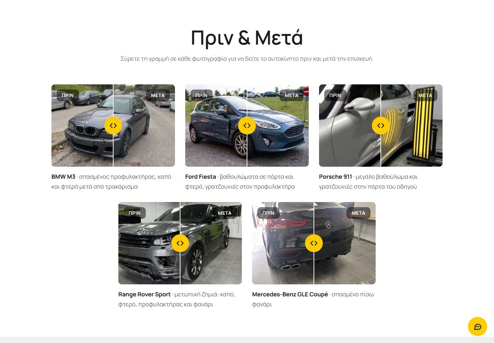
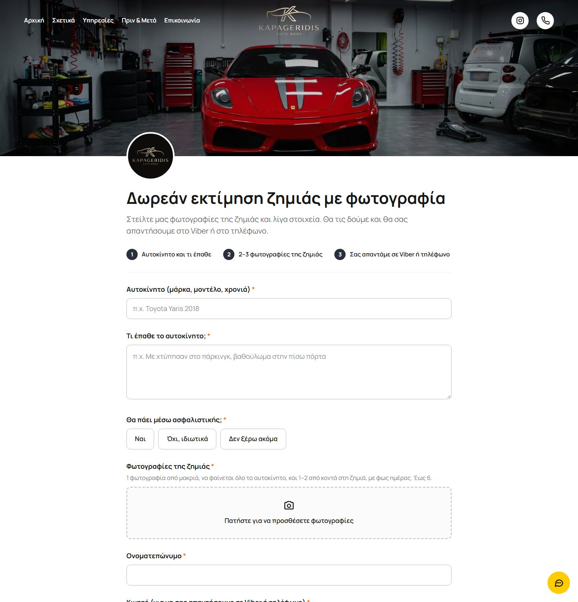
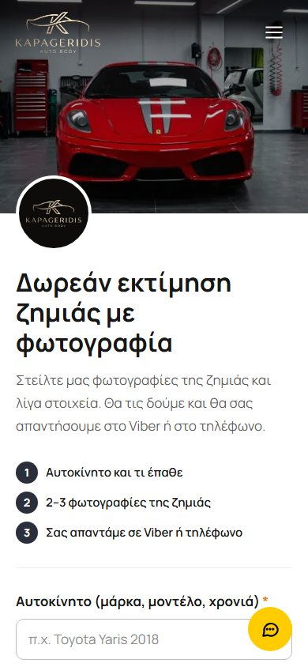
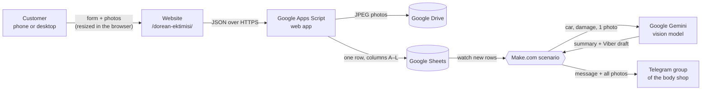
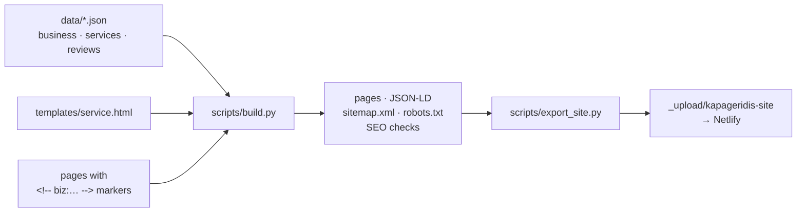

<p align="center">
  
</p>

<h1 align="center">Kapageridis Auto Body — website &amp; automations</h1>

<p align="center">
  A fast, hand-built website for a family body shop in Thessaloniki, Greece — with a
  photo-based <b>free damage estimate</b> that lands in the shop owner's Telegram,
  summarised by AI.
</p>

<p align="center">
  
  
  
  
  
  
  
  
  
  
</p>

---

## Highlights

- **Zero frameworks, zero runtime dependencies.** Semantic HTML, modern CSS and small vanilla JS modules. The build needs nothing but the Python standard library.
- **Design system first.** Every colour, spacing and radius comes from CSS custom properties (`design-system/tokens.css`), documented in [`DESIGN.md`](design-system/DESIGN.md).
- **Single source of truth.** Business details live once in `data/business.json` and are written into every page by the build: header, footer, opening hours, map, structured data, privacy policy.
- **Free estimate → AI → Telegram.** Customers send the car, the damage and photos. The shop owner gets a Telegram message with the photos and a short AI summary, without opening any dashboard.
- **SEO, GEO &amp; AEO ready.** JSON-LD for the business, services, breadcrumbs and FAQs; a generated sitemap; `robots.txt` that welcomes AI crawlers; an automatic check of titles, descriptions, H1s and schema on every build.
- **Privacy by design (GDPR).** Self-hosted fonts, analytics only after explicit consent, EXIF/GPS stripped from customer photos in the browser, and a privacy page generated from the same config as the features it describes.
- **Lightweight media pipeline.** Responsive WebP images, and seamless looping hero videos cut from 4K footage: an 87&nbsp;MB source becomes ~2&nbsp;MB on desktop and ~0.5&nbsp;MB on phones.
- **Accessible.** Keyboard and screen-reader friendly menus, form and before/after sliders; every animation respects `prefers-reduced-motion`.

## Screenshots

| Services | Before &amp; after sliders |
|---|---|
|  |  |
| **Service page with looping video** | **Google reviews** |
|  |  |

<p align="center">
  
  &nbsp;
  
  &nbsp;
  
</p>

## How the free estimate works

The site's own form replaced a third-party form builder without changing the downstream automation: a small Google Apps Script writes exactly the row format the existing Make scenario already understood.



- **In the browser** ([`js/estimate.js`](js/estimate.js)): photos are re-encoded on a `<canvas>` (longest side 1600&nbsp;px, JPEG), which shrinks a typical phone photo by ~75% and removes hidden metadata. Answers are validated with clear Greek messages; phone numbers are normalised (`6944 123 456` → `306944123456`).
- **On Google** ([`scripts/estimate-apps-script.gs`](scripts/estimate-apps-script.gs)): saves the photos to Drive with link sharing, appends one row with a script lock, and drops spam (hidden honeypot field + minimum fill time) without telling bots.
- **In Make**: the Gemini prompt follows strict rules — no prices, no repair-time promises, no number plates or faces, plain text only — and an error handler still sends the Telegram message if the AI is unavailable.

## How the site is built



| Script | What it does |
|---|---|
| [`scripts/build.py`](scripts/build.py) | Fills every `<!-- biz:NAME -->` block, `data-biz` text and `data-biz-attrs` attribute from `data/business.json`; generates the three service pages from one template; writes JSON-LD (`AutoBodyShop`, `Service`, `BreadcrumbList`, `FAQPage`, `OfferCatalog`), `sitemap.xml` and `robots.txt`; flags any page whose title, description, H1 or JSON-LD is off. |
| [`scripts/export_site.py`](scripts/export_site.py) | Crawls every page and stylesheet and copies **only** the files the site really uses into a deployable folder. `--demo` adds `noindex` for preview links. |
| [`scripts/service_images.py`](scripts/service_images.py) | Pillow: WebP 800/1600 versions, never upscaled, EXIF removed, sizes recorded for `width`/`height`. |
| [`scripts/service_videos.py`](scripts/service_videos.py) | ffmpeg: cuts the best segment, makes it loop without a visible jump (crossfade for people, forward-and-back for camera moves), exports desktop and phone versions and a poster frame. |

## Tech stack

| Area | Tools |
|---|---|
| Front end | Semantic HTML5 · CSS custom properties, Grid &amp; subgrid, `clamp()`, `color-mix()` · vanilla JavaScript (IntersectionObserver, Canvas, Fetch) |
| Build &amp; media | Python 3 (standard library) · Pillow · ffmpeg |
| SEO | schema.org JSON-LD · Open Graph · sitemap · generated `robots.txt` (search and AI crawlers) |
| Privacy | Self-hosted Manrope font · Google Analytics 4 behind a consent banner (ads signals off) · generated privacy policy |
| Automation | Google Apps Script · Google Sheets &amp; Drive · Make.com · Google Gemini · Telegram Bot API |
| Hosting &amp; workflow | Netlify · Git &amp; GitHub · Claude Code (AI pair programming) |

## Project structure

```text
├── index.html, 404.html          home page and not-found page
├── fanopoiia/ vafi-aftokinitou/ pdr/   service pages (generated – do not edit)
├── dorean-ektimisi/              free estimate page with the form
├── politiki-aporritou/           privacy policy (generated from the config)
├── data/                         business.json · services.json · reviews.json
├── templates/service.html        one template for all service pages
├── design-system/                tokens.css · components · fonts · DESIGN.md
├── css/  js/                     site styles and small scripts
├── images/  assets/              photos (WebP) and videos (MP4)
├── scripts/                      build, export, image and video tools, Apps Script
└── docs/screenshots/             images for this README
```

## Run it locally

```bash
python .claude/dev_server.py        # http://localhost:8080 (also serves 404.html)
python scripts/build.py             # rebuild pages, sitemap, robots.txt and run the checks
python scripts/export_site.py       # deployable folder: _upload/kapageridis-site
```

Change business details only in `data/business.json` and texts in `data/services.json`, then run the build.

**Deploy:** every push to `main` is built and published by Netlify using [`netlify.toml`](netlify.toml) — the same two commands, plus security headers and cache rules.

## Credits

Designed and developed by **Kallistratis** — built with [Claude Code](https://claude.com/claude-code) as an AI pair programmer.
Client: *Καπαγερίδης Ιωάννης – Φανοποιείο · Βαφείο · PDR*, Pylaia, Thessaloniki.

## License

Source code © 2026 Kallistratis. All rights reserved — shared here as a portfolio piece.
The business name, logo, photos, videos and texts belong to the body shop and are not licensed for reuse.
