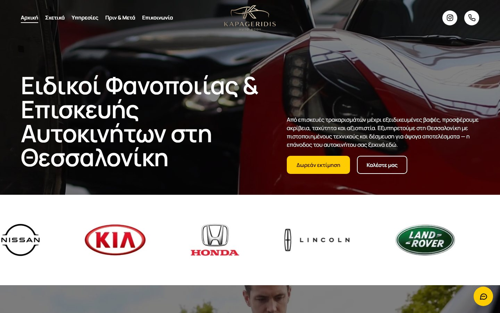
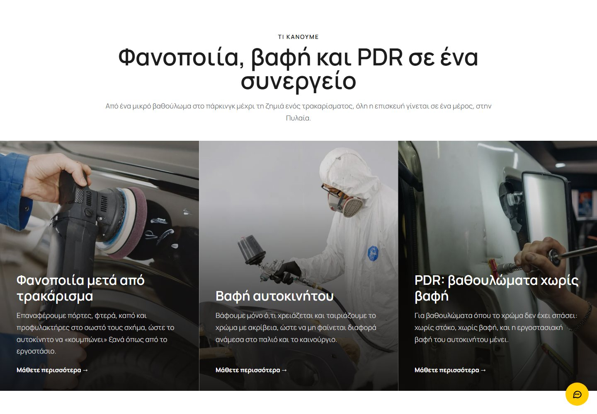
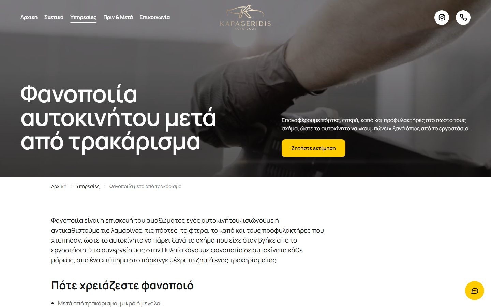
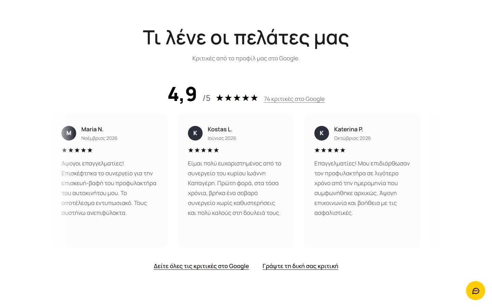
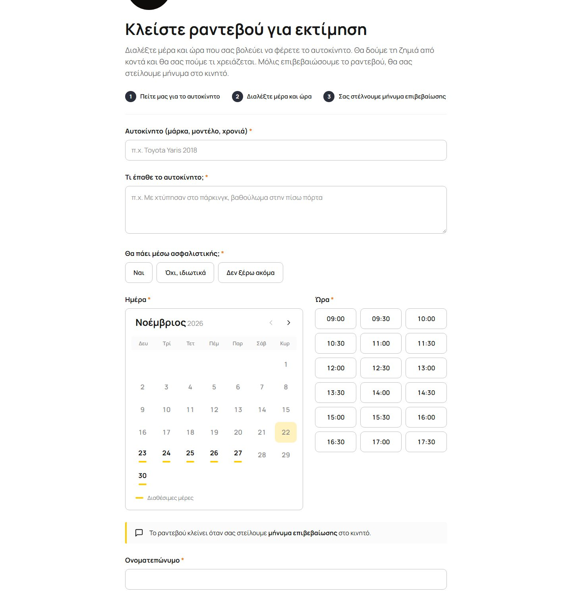
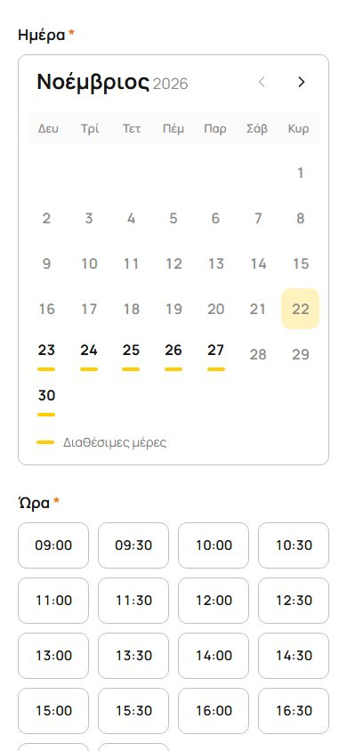
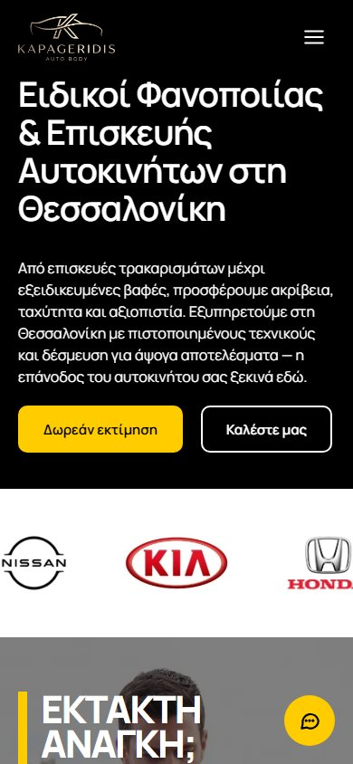
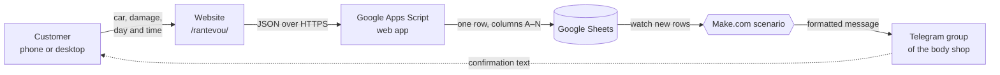
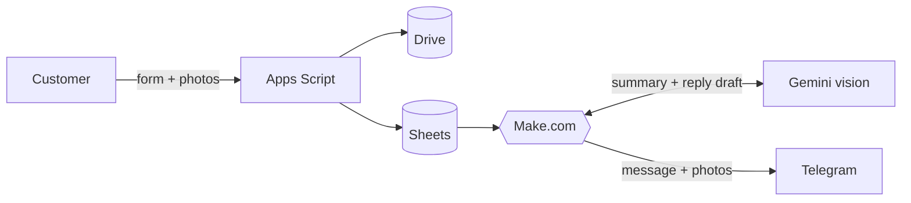
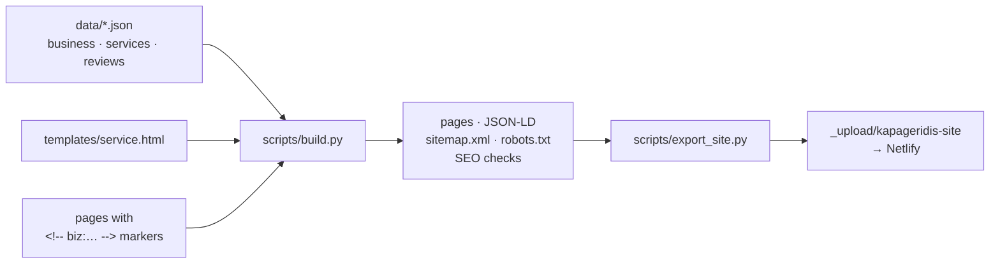

<p align="center">
  
</p>

<h1 align="center">Kapageridis Auto Body — website &amp; automations</h1>

<p align="center">
  A fast, hand-built website for a family body shop in Thessaloniki, Greece — with an
  <b>online appointment calendar</b> whose requests land in the shop owner's Telegram,
  ready for a confirmation text. Its first version analysed damage photos with
  <b>Google Gemini</b>.
</p>

<p align="center">
  <b>Built 100% with agentic AI</b> — every line of code written by
  <a href="https://claude.com/claude-code">Claude Code</a>, directed by me.
</p>

<p align="center">
  
  
  
  
  
  
  
  
  
  
  
</p>

---

## Highlights

- **Built entirely with agentic AI.** No code was written by hand: an AI agent (Claude Code) planned, wrote, tested and shipped everything, from my instructions. See [how](#built-with-agentic-ai).
- **Bilingual, Greek and English.** One build writes both languages from the same data: localized header, footer, forms and privacy policy, `hreflang` links, an EN/ΕΛ switch and a sitemap with language alternates. Customer reviews stay word for word in Greek.
- **Zero frameworks, zero runtime dependencies.** Semantic HTML, modern CSS and small vanilla JS modules. The build needs nothing but the Python standard library.
- **Design system first.** Every colour, spacing and radius comes from CSS custom properties (`design-system/tokens.css`), documented in [`DESIGN.md`](design-system/DESIGN.md).
- **Single source of truth.** Business details live once in `data/business.json` and are written into every page by the build: header, footer, opening hours, map, structured data, privacy policy.
- **Two generations of automation.** v1: customers sent photos, the owner got them in Telegram with a Google Gemini damage summary and a reply draft. v2: an appointment calendar, because the owner prefers to see every car in person. Both write the same sheet columns, so the switch needed no data migration and no new Make connections.
- **Appointment request → Telegram.** Customers describe the car and the damage and pick a day in a small month calendar and a half-hour slot. The shop owner gets one tidy Telegram message and confirms with a text message, without opening any dashboard.
- **SEO, GEO &amp; AEO ready.** JSON-LD for the business, services, breadcrumbs and FAQs; a generated sitemap; `robots.txt` that welcomes AI crawlers; an automatic check of titles, descriptions, H1s and schema on every build.
- **Privacy by design (GDPR).** Self-hosted fonts, analytics only after explicit consent, a form that asks only what the appointment needs, and a privacy page generated from the same config as the features it describes.
- **Lightweight media pipeline.** Responsive WebP images, and seamless looping hero videos cut from 4K footage: an 87&nbsp;MB source becomes ~2&nbsp;MB on desktop and ~0.5&nbsp;MB on phones.
- **Accessible.** Keyboard and screen-reader friendly menus, form and before/after sliders; every animation respects `prefers-reduced-motion`.

## Screenshots

| Services | Before &amp; after sliders |
|---|---|
|  |  |
| **Service page with looping video** | **Google reviews** |
|  |  |

<p align="center">
  
  &nbsp;
  
  &nbsp;
  
</p>

## How appointment requests work

The estimate happens at the shop, so the site books the visit instead of collecting photos. The form replaced an earlier photo form without breaking the downstream automation: a small Google Apps Script keeps the same sheet columns and adds the appointment at the end.



- **In the browser** ([`js/appointment.js`](js/appointment.js)): draws a month calendar where only the working days of the next 30 days are open, skipping weekends and Greek public holidays, including the moving Orthodox Easter holidays (computed with Meeus' algorithm), and half-hour slots generated from the opening hours in `data/business.json`. Answers are validated with clear Greek messages; mobile numbers are normalised (`6944 123 456` → `306944123456`), since the confirmation is a text message.
- **On Google** ([`scripts/appointment-apps-script.gs`](scripts/appointment-apps-script.gs)): checks everything again on the server (weekday, 1–60 days ahead, inside opening hours), appends one row with a script lock, and drops spam (hidden honeypot field + minimum fill time) without telling bots.
- **In Make**: watches the sheet for new rows and sends one Telegram message with the car, the damage, the insurance and the requested day and time.

### Version 1: AI photo estimate

Before the calendar, the same pipeline carried **photos**: the browser resized them, Apps Script stored them in Google Drive, and Make asked **Google Gemini** for a short damage summary and a reply draft before posting everything to Telegram.



The code, the Gemini instructions and the Make scenario (without account data) are kept in [`automations/photo-estimate-v1/`](automations/photo-estimate-v1/).

## How the site is built



| Script | What it does |
|---|---|
| [`scripts/build.py`](scripts/build.py) | Fills every `<!-- biz:NAME -->` block, `data-biz` text and `data-biz-attrs` attribute from `data/business.json`; generates the three service pages from one template; writes JSON-LD (`AutoBodyShop`, `Service`, `BreadcrumbList`, `FAQPage`, `OfferCatalog`), `sitemap.xml` and `robots.txt`; flags any page whose title, description, H1 or JSON-LD is off. |
| [`scripts/export_site.py`](scripts/export_site.py) | Crawls every page and stylesheet and copies **only** the files the site really uses into a deployable folder. `--demo` adds `noindex` for preview links. |
| [`scripts/service_images.py`](scripts/service_images.py) | Pillow: WebP 800/1600 versions, never upscaled, EXIF removed, sizes recorded for `width`/`height`. |
| [`scripts/service_videos.py`](scripts/service_videos.py) | ffmpeg: cuts the best segment, makes it loop without a visible jump (crossfade for people, forward-and-back for camera moves), exports desktop and phone versions and a poster frame. |

## Built with agentic AI

This project was built end to end through **agentic AI development**. I did not write the code by hand. I gave [Claude Code](https://claude.com/claude-code), Anthropic's agentic coding tool, instructions in plain Greek. The agent then planned and did the work itself inside the repository:

- **Code:** wrote and refactored all the HTML, CSS, JavaScript and Python, following the design system's tokens and rules.
- **Testing:** ran the build, the SEO checks and a local server, then tested pages in a real browser: forms with mocked requests, holidays in the calendar, mobile and desktop screenshots.
- **Media:** produced responsive WebP images with Pillow and seamless looping videos with ffmpeg, and blurred customers' number plates.
- **Automations:** built the Google Apps Script receivers, the Make.com scenario blueprints and the Telegram message templates, and kept the privacy policy in step with them.
- **Shipping:** handled Git, the Netlify configuration and this README, and checked for keys and personal data before every push.

**My role** was product owner and reviewer:
- set the goals and the client's requirements;
- supplied the business details, photos and videos;
- made the design and product decisions, such as replacing the AI photo estimate with an appointment calendar;
- reviewed every result;
- handled the accounts (Google, Make, Telegram, Netlify, GitHub).

## Tech stack

| Area | Tools |
|---|---|
| Front end | Semantic HTML5 · CSS custom properties, Grid &amp; subgrid, `clamp()`, `color-mix()` · vanilla JavaScript (IntersectionObserver, Fetch) |
| Build &amp; media | Python 3 (standard library) · Pillow · ffmpeg |
| SEO | schema.org JSON-LD · Open Graph · sitemap · generated `robots.txt` (search and AI crawlers) |
| Privacy | Self-hosted Manrope font · Google Analytics 4 behind a consent banner (ads signals off) · generated privacy policy |
| Automation | Google Apps Script · Google Sheets · Make.com · Telegram Bot API · v1: Google Drive, Google Gemini, Canvas image resizing |
| Hosting &amp; workflow | Netlify · Git &amp; GitHub · Claude Code (agentic AI development) |

## Project structure

```text
├── index.html, 404.html          home page and not-found page
├── fanopoiia/ vafi-aftokinitou/ pdr/   service pages (generated – do not edit)
├── rantevou/                     appointment page with the form
├── en/                           English version: home, services (generated), appointment, privacy
├── politiki-aporritou/           privacy policy (generated from the config)
├── data/                         business.json · services.json · reviews.json
├── templates/service.html        one template for all service pages
├── design-system/                tokens.css · components · fonts · DESIGN.md
├── css/  js/                     site styles and small scripts
├── images/  assets/              photos (WebP) and videos (MP4)
├── scripts/                      build, export, image and video tools, Apps Script
├── automations/photo-estimate-v1/   first automation: AI photo estimate (archived)
└── docs/screenshots/             images for this README
```

## Run it locally

```bash
python .claude/dev_server.py        # http://localhost:8080 (also serves 404.html)
python scripts/build.py             # rebuild pages, sitemap, robots.txt and run the checks
python scripts/export_site.py       # deployable folder: _upload/kapageridis-site
```

Change business details only in `data/business.json` and texts in `data/services.json` (English: `data/services.en.json`), then run the build.

**Deploy:** every push to `main` is built and published by Netlify using [`netlify.toml`](netlify.toml) — the same two commands, plus security headers and cache rules.

## Credits

Created and directed by **Kallistratis** — built entirely with agentic AI ([Claude Code](https://claude.com/claude-code)).
Client: *Καπαγερίδης Ιωάννης – Φανοποιείο · Βαφείο · PDR*, Pylaia, Thessaloniki.

## License

Source code © 2026 Kallistratis. All rights reserved — shared here as a portfolio piece.
The business name, logo, photos, videos and texts belong to the body shop and are not licensed for reuse.
