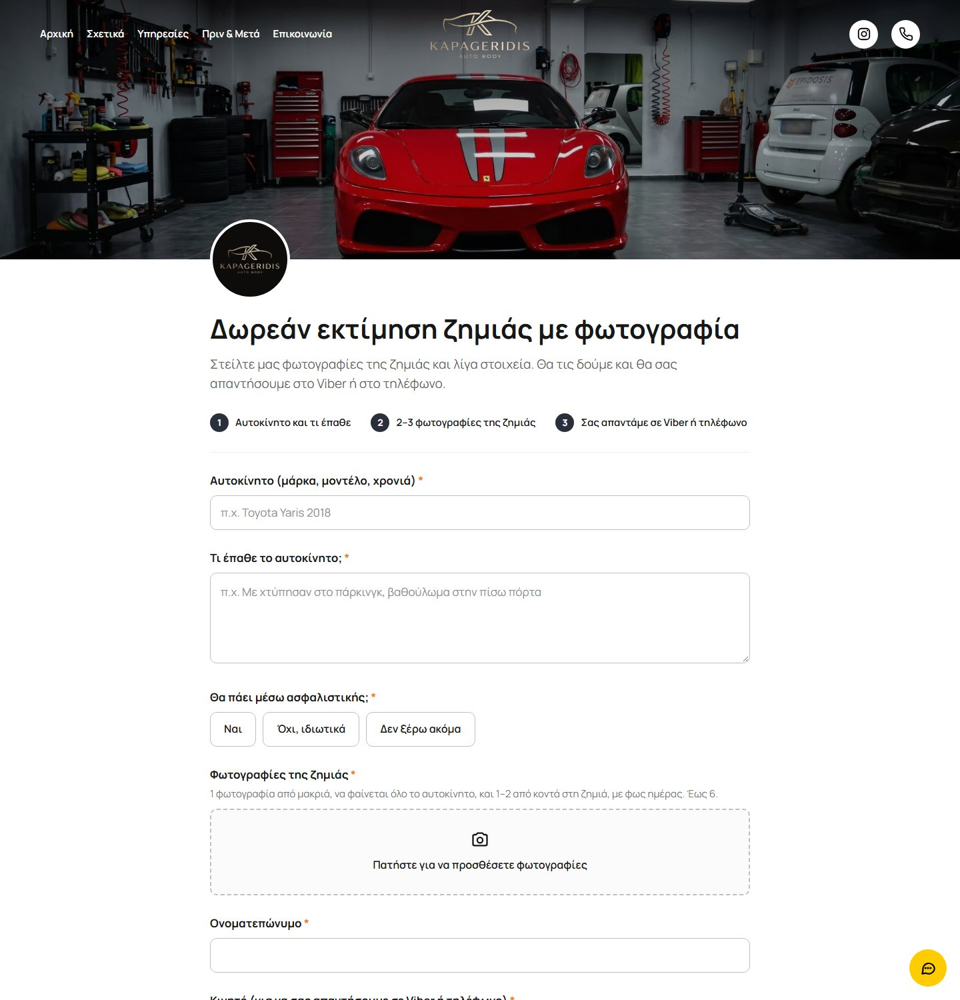
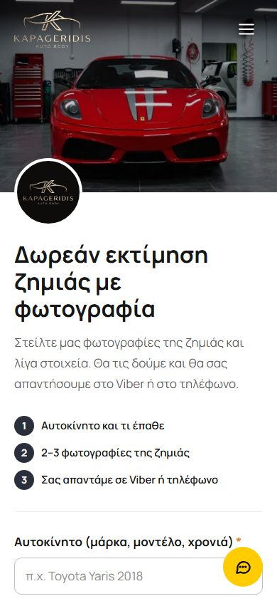
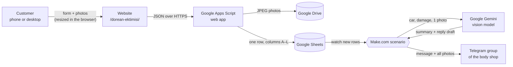

# Automation v1 — AI photo estimate

The first automation of the site (2026): customers sent photos of the damage, and the
shop owner received them in Telegram together with a short **Google Gemini** analysis
and a draft reply. It worked end to end in production.

It was later replaced by an [appointment calendar](../../README.md#how-appointment-requests-work),
because the owner prefers to see every car in person before giving an estimate. The
code is kept here as it was, as part of the project's history. **The site no longer
uses these files.**

<p align="center">
  
  &nbsp;
  
</p>

## How it worked



It started on a third-party form builder. The site's own form later replaced it
**without touching the Make scenario**: the Apps Script writes exactly the row format the
scenario already understood.

| File | What it did |
|---|---|
| [`estimate.js`](estimate.js) | The form in the browser. Photos are re-encoded on a `<canvas>` (longest side 1600&nbsp;px, JPEG): a typical phone photo shrinks by ~75% and loses its hidden metadata (EXIF, GPS). Up to 6 photos with thumbnails and remove buttons, validation with clear Greek messages, phone numbers normalised (`6944 123 456` → `306944123456`). |
| [`estimate-apps-script.gs`](estimate-apps-script.gs) | The receiver inside the Google Sheet. Saves the photos to a Drive folder, shared by link. Appends one row with a script lock and drops spam (hidden honeypot field + minimum fill time) without telling bots. |
| [`make-scenario.blueprint.json`](make-scenario.blueprint.json) | The Make.com scenario, exported **without account data**: connections, sheet and chat IDs are placeholders. |

## The Make scenario

1. **Google Sheets – Watch New Rows** picks up each new request.
2. **Google Gemini – Generate a response** (`gemini-3.5-flash-lite`) gets the car, the damage, the insurance answer and the first photo.
   - An error handler (*Resume*) gives an empty result if the AI is unavailable, so the message is still sent.
3. **Telegram – Send a Text Message**: the customer's details and the AI summary. If the summary is missing, the message says so.
4. **Iterator → HTTP – Download a file → Telegram – Send a Photo** posts every photo under the message.
   - Each step has an *Ignore* handler, so one broken photo never stops the rest.

### The Gemini instructions

The system prompt (in Greek) asks for a fixed, plain-text summary **for the owner**:

```text
ΣΗΜΕΙΟ            which part of the car
ΖΗΜΙΑ             type (dent, scratch, crack, chipped paint, rust) and rough size
ΠΙΘΑΝΗ ΔΟΥΛΕΙΑ    PDR without paint / body work and paint / new part / polishing,
                  always worded as "looks like…", never as a certainty
ΣΟΒΑΡΟΤΗΤΑ        small / medium / large
ΤΙ ΛΕΙΠΕΙ         which photo or detail would help
ΠΡΟΣΧΕΔΙΟ         2–3 polite sentences the owner can send to the customer
```

It also has strict rules:
- never a price, cost or discount;
- never a promise about repair time;
- say so when the photo does not show the damage clearly;
- do not invent anything that is not visible;
- never mention number plates or faces;
- plain text only, without formatting.
